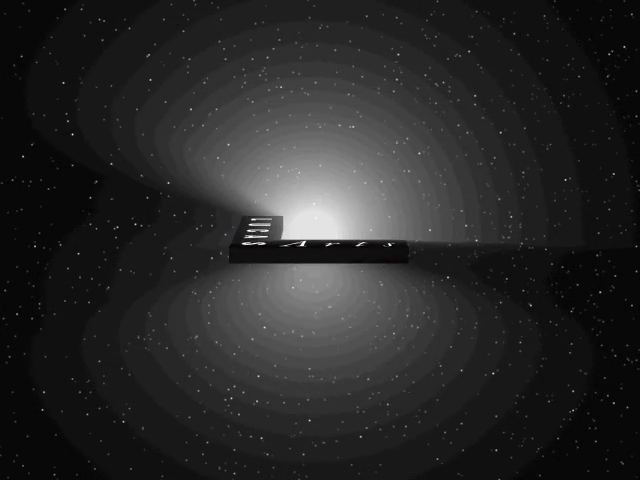

# Star Wars Rebellion — Static Recompilation

Static recompilation of **Star Wars: Rebellion** (Coolhand Interactive /
LucasArts, 1998) from its shipping Win32 executable, `REBEXE.EXE`, to native C.

Built on [pcrecomp](https://github.com/sp00nznet/pcrecomp)'s 32-bit pipeline
(`disasm32` → `lift32`) and its `native32` host, the same toolkit that runs
[Fallout Tactics](https://github.com/sp00nznet/fallouttactics-recomp). This
repository holds only what is Rebellion's own: how to lift it, the host's
game-specific parts, and the notes.



## Status

**Pre-alpha: the recompiled game boots and plays its intro movie.**

| | |
|---|---|
| Binary | `REBEXE.EXE`, 2,822,656 bytes, PE32, MSVC 5 (linker 5.10), built 1998-05-22 |
| Code | 2.45 MB of `.text` |
| Catalog | 34,425 functions, 93.4% of `.text` (`disasm32`, about 3 minutes) |
| Lift | 34,425 functions, 0 errors, 2.8M lines of C (about 2 minutes) |
| Display | DirectDraw, 640x480 in 256 colours; the intro movies are Smacker |

The game runs its own code from the entry point: the C runtime, its registry
lookups, DirectDraw, DirectSound and its sound thread. Then the Smacker intro
plays. Nothing past the intro has been reached yet; see [ROADMAP.md](ROADMAP.md).

Only `REBEXE.EXE` is lifted. The large DLLs beside it (`STRATEGY.DLL`,
`ALSPRITE.DLL`, `EMBRIEF.DLL`, ...) import nothing but KERNEL32 and hold the
game's art, text and voice; they load as they are. `SMACKW32.DLL` (Smacker)
and `d3drm.dll` (Direct3D Retained Mode) are third-party libraries and run
natively.

## What it took

- **The registry key, answered by the host.** The installer writes
  `HKLM\SOFTWARE\LucasArts Entertainment Company LLC\Star Wars Rebellion` with
  where everything lives. A copied install has no key, so the game read no
  `TooBigLocation`, looked for its CD and stopped with "CD Not Found". The host
  answers that one key itself, with every location pointing at the game folder,
  and writes nothing to the machine's registry.
- **Activation.** The game waits for `WM_ACTIVATEAPP` before it starts. It
  creates a hidden window and then its 640x480 one, and the host now activates
  the window the game shows, not the first one created.
- **256 colours.** The virtual display reports an 8-bit mode as
  palette-indexed, and frames are converted through the primary's palette.
- **`TerminateThread` and the machine lock**
  ([pcrecomp #120](https://github.com/sp00nznet/pcrecomp/pull/120)). The
  movie player kills its worker thread. When that thread was waiting for
  native32's machine lock, the lock was left broken, and the next thread to
  wait on it, the sound thread, faulted inside ntdll. Fixed in native32 for
  every host.
- **GDI frames.** Before the game creates any DirectDraw surface, Smacker
  draws the intro into the window with GDI, so the host captures the window
  when there is no primary surface.

## Building

You need your own copy of Star Wars: Rebellion (the Steam release). Nothing
from the game is in this repository, and nothing ever will be.

1. Visual Studio 2022 (or the Build Tools) with the C++ x86 tools, CMake,
   Ninja, Python 3 with `capstone`, and ffmpeg on `PATH` for recordings.
2. Check out [pcrecomp](https://github.com/sp00nznet/pcrecomp) beside this
   repository as `tools/`.
3. Copy the installed game into `game\`.
4. Classes, vtables and the function catalog (about 3 minutes):

   ```bat
   py -3 ..\tools\tools\cpp\rtti.py game\REBEXE.EXE -o work\rtti.json --seeds work\rtti_seeds.json
   py -3 ..\tools\tools\cpp\vtable_scan.py game\REBEXE.EXE -o work\vtables.json --seeds work\vtable_seeds.json
   py -3 -c "import json; s={x['address']:x for f in ('work/rtti_seeds.json','work/vtable_seeds.json') for x in json.load(open(f))}; json.dump(sorted(s.values(), key=lambda x: x['address']), open('work/seeds.json','w'))"
   py -3 ..\tools\tools\disasm\disasm32.py game\REBEXE.EXE -o work\functions.json --seed-functions work\seeds.json
   ```

   Only the C runtime's iostream classes carry RTTI. `vtable_scan` finds the
   game's own vtables from their shape.
5. Lift, then build:

   ```bat
   py -3 run_lift.py --all
   build.cmd
   ```

6. Run. `--headless` keeps everything off the screen, and `--record` writes
   what the game shows to a video:

   ```bat
   build\rebellion.exe --headless --run --watchdog 40 --record work\run.mp4
   build\rebellion.exe --run          :: the presenter: the game in a window of its own
   ```

   `--original` runs the shipping machine code under the same host, as a
   reference for the lift.

The lifted C is written to `src\recomp\gen\` and the analysis to `work\`, both
gitignored. They are derived from your copy of the game and are never
committed.

## License

[MIT](LICENSE), for what this repository holds: the lift driver, the host
(`src/runtime/`), the build files, the scripts and the documentation. The host
began as a copy of Fallout Tactics' and Red Alert 2's, which carry the same
licence.

It does not cover Star Wars: Rebellion. The game, its executable, data, art,
movies, music and voice are Lucasfilm's and LucasArts'. None of them is in
this repository. The C that `run_lift.py` generates from `REBEXE.EXE` is a
derivative of that executable. It is written into `src\recomp\gen\` from your
own copy and is never committed, and the MIT licence grants nothing in it.
